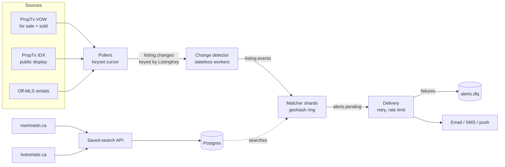

# listing-alerts

A real-time listing alert engine in Go. It ingests MLS® listing changes from RESO Web API feeds, works out
what changed, matches each change against saved searches, and sends alerts within a second: new listings,
price drops, sold or leased (with the price where the data allows it) and back on the market.

It is built for two production sites, [mertmetin.ca](https://mertmetin.ca) (homes for sale) and
[hotrentals.ca](https://hotrentals.ca) (Ontario rentals), and load-tested at Canada-wide volume.

> **Status: milestone 4 of 6.** Live on the PropTx VOW and IDX feeds (about 89K and 81K residential listings)
> and hotrentals.ca's off-MLS rentals: pollers → change detection with geocoding → sharded matching against
> saved searches (p50 0.4 ms against 1M) → email delivery with digests, per-user rate limits, retries, a
> dead-letter topic and one-click unsubscribe. In development all email goes to Mailpit. Scale and chaos
> tests come next. Design notes: [ingestion](docs/design/ingestion.md), [change detection](docs/design/detection.md),
> [matching](docs/design/matching.md), [delivery](docs/design/delivery.md); plan: [docs/PLAN.md](docs/PLAN.md).

## Architecture (target)



## Run it

You need Docker and Go 1.27+.

```bash
make up      # creates .env with random local passwords, builds, starts, runs the smoke test
make test    # unit tests with the race detector
make itest   # integration tests against the running stack (Postgres, Redpanda)
make live    # also starts the pollers; needs PropTx tokens (make tokens copies them from the macOS Keychain)
make events  # the latest listing events from the live feed
make down    # stop (make clean also deletes the data)
```

| Service | URL |
| --- | --- |
| API readiness | http://localhost:8081/readyz |
| Grafana | http://localhost:3300 (user `admin`, password in `.env`): *Platform*, *Ingestion*, *Change detection*, *Matching* and *Delivery* dashboards |
| Prometheus | http://localhost:9091 |
| Redpanda Console | http://localhost:8180 |
| Mailpit (every email in development) | http://localhost:8025 |

Run `make hooks` once to block commits that contain secrets.

### Saved-search API

Each site gets a key (`make apikey SITE=mertmetin`, printed once, only its hash is stored) and calls the API for
its signed-in users. `audience` is `vow` only for users who registered, confirmed their email and are logged in:
they get sold and leased prices. Everyone else is `public`.

```bash
curl -X POST http://localhost:8081/v1/searches -H "Authorization: Bearer $SITE_KEY" -d '{
  "user_id": "1234", "email": "buyer@example.com", "audience": "vow", "name": "Orleans under $800K",
  "transaction": "sale", "max_price": 800000, "min_beds": 3,
  "areas": [[{"lat":45.45,"lng":-75.55},{"lat":45.45,"lng":-75.45},{"lat":45.50,"lng":-75.45},{"lat":45.50,"lng":-75.55}]]
}'
```

`GET /v1/searches?user_id=…`, `GET|PUT|DELETE /v1/searches/{id}`. Searches can use drawn `areas` (up to 10
polygons) and/or `cities`, plus `min_price`, `max_price`, `min_beds`, `min_baths`, `types` and `events`.

Run `make geodata` once to copy hotrentals.ca's Ontario address points (municipal open data) for geocoding, and
`make matchbench` for the 1M-search benchmark.

## License

MIT
