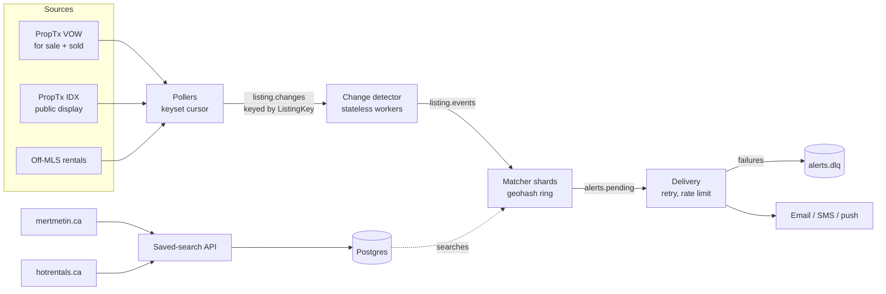

# listing-alerts

A real-time listing alert engine in Go. It ingests MLS® listing changes from RESO Web API feeds, works out
what changed, matches each change against saved searches, and sends alerts within a second: new listings,
price drops, sold or leased (with the price where the data allows it) and back on the market.

It is built for two production sites, [mertmetin.ca](https://mertmetin.ca) (homes for sale) and
[hotrentals.ca](https://hotrentals.ca) (Ontario rentals), and load-tested at Canada-wide volume.

> **Status: milestone 2 of 6.** Live on the PropTx VOW and IDX feeds (about 89K and 81K residential listings)
> and hotrentals.ca's off-MLS rentals. Pollers publish deduplicated, idempotent change events; a scalable
> group of stateless detectors turns them into new listing, price drop, sold, leased and back-on-market events.
> Saved-search matching comes next. Design notes: [ingestion](docs/design/ingestion.md),
> [change detection](docs/design/detection.md); plan: [docs/PLAN.md](docs/PLAN.md).

## Architecture (target)



## Run it

You need Docker and Go 1.27+.

```bash
make up      # creates .env with random local passwords, builds, starts, runs the smoke test
make test    # unit tests with the race detector
make itest   # integration tests against the running stack (Postgres, Redpanda)
make live    # also starts the pollers; needs PropTx tokens (make tokens copies them from the macOS Keychain)
make events  # the latest listing events from the live feed
make down    # stop (make clean also deletes the data)
```

| Service | URL |
| --- | --- |
| API readiness | http://localhost:8081/readyz |
| Grafana | http://localhost:3300 (user `admin`, password in `.env`): *Platform*, *Ingestion* and *Change detection* dashboards |
| Prometheus | http://localhost:9091 |
| Redpanda Console | http://localhost:8180 |
| Mailpit (caught emails) | http://localhost:8025 |

Run `make hooks` once to block commits that contain secrets.

## License

MIT
