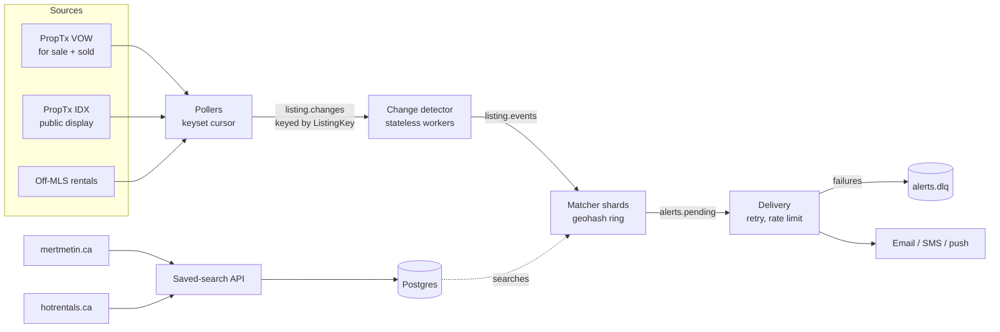

# listing-alerts

A real-time listing alert engine in Go. It ingests MLS® listing changes from RESO Web API feeds, works out
what changed, matches each change against saved searches, and sends alerts within a second: new listings,
price drops, sold or leased (with the price where the data allows it) and back on the market.

It is built for two production sites, [mertmetin.ca](https://mertmetin.ca) (homes for sale) and
[hotrentals.ca](https://hotrentals.ca) (Ontario rentals), and load-tested at Canada-wide volume.

> **Status: in production.** Runs on a small VPS in Toronto against the live PropTx VOW and IDX feeds
> (88,549 and 80,120 residential listings): pollers → change detection with geocoding → saved-search matching
> → email delivery with digests, rate limits, retries, a dead-letter topic and one-click unsubscribe. The API is
> at `https://alerts.mertmetin.ca`. Email runs in shadow mode (Mailpit) until it's compared with the current
> alerts. Design notes: [ingestion](docs/design/ingestion.md), [change detection](docs/design/detection.md),
> [matching](docs/design/matching.md), [delivery](docs/design/delivery.md), [scale and chaos](docs/design/scale.md),
> [production](docs/design/production.md); plan: [docs/PLAN.md](docs/PLAN.md).

## Results

Measured on one laptop (Apple M-series, 10 cores, Docker with 8 GB). Details and method are in
[docs/design/scale.md](docs/design/scale.md).

| Test | Result |
| --- | --- |
| Burst: 250K changes re-sent at once (3-broker cluster, 3 detectors, 3 shards) | drained in **8.6 s** (29K changes/s; 49K alerts/s matched) |
| Latency at steady load, change → alert published | **p50 6 ms, p99 103 ms** |
| Chaos: a detector, a matcher shard, a broker and delivery SIGKILLed under 1,500 changes/s | **0 alerts lost, 0 duplicated** (364,465 audited) |
| Matching against 1M saved searches, one core | p50 0.37 ms, p99 1.98 ms; 14.7K events/s on 10 cores |
| Saved-search API (k6, ~960 req/s) | p99 8 ms create, 5.7 ms list, 0 errors |
| Live: MLS change → email in Mailpit | about 1.5–2.5 min, mostly the 60 s poll |

The auditor proves "nothing lost" exactly rather than by sampling. It replays the generated changes through the
same rule functions to derive every event and alert ID that must exist, then checks each one against what the
system produced.

## Architecture (target)



## Run it

You need Docker and Go 1.27+.

```bash
make up      # creates .env with random local passwords, builds, starts, runs the smoke test
make test    # unit tests with the race detector
make itest   # integration tests against the running stack (Postgres, Redpanda)
make live    # also starts the pollers; needs PropTx tokens (make tokens copies them from the macOS Keychain)
make events  # the latest listing events from the live feed
make down    # stop (make clean also deletes the data)
```

| Service | URL |
| --- | --- |
| API readiness | http://localhost:8081/readyz |
| Grafana | http://localhost:3300 (user `admin`, password in `.env`): *Platform*, *Ingestion*, *Change detection*, *Matching* and *Delivery* dashboards |
| Prometheus | http://localhost:9091 |
| Redpanda Console | http://localhost:8180 |
| Mailpit (every email in development) | http://localhost:8025 |

Run `make hooks` once to block commits that contain secrets.

### Saved-search API

Each site gets a key (`make apikey SITE=mertmetin`, printed once, only its hash is stored) and calls the API for
its signed-in users. `audience` is `vow` only for users who registered, confirmed their email and are logged in:
they get sold and leased prices. Everyone else is `public`.

```bash
curl -X POST http://localhost:8081/v1/searches -H "Authorization: Bearer $SITE_KEY" -d '{
  "user_id": "1234", "email": "buyer@example.com", "audience": "vow", "name": "Orleans under $800K",
  "transaction": "sale", "max_price": 800000, "min_beds": 3,
  "areas": [[{"lat":45.45,"lng":-75.55},{"lat":45.45,"lng":-75.45},{"lat":45.50,"lng":-75.45},{"lat":45.50,"lng":-75.55}]]
}'
```

`GET /v1/searches?user_id=…`, `GET|PUT|DELETE /v1/searches/{id}`. Searches can use drawn `areas` (up to 10
polygons) and/or `cities`, plus `min_price`, `max_price`, `min_beds`, `min_baths`, `types` and `events`.

Run `make geodata` once to copy hotrentals.ca's Ontario address points (municipal open data) for geocoding, and
`make matchbench` for the 1M-search benchmark.

## License

MIT
