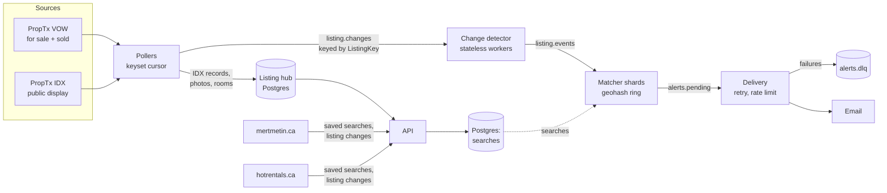

# listing-alerts

A real-time listing alert engine in Go. It ingests MLS® listing changes from RESO Web API feeds, works out
what changed, matches each change against saved searches, and sends alerts within a second: new listings,
price drops, sold or leased (with the price where the data allows it) and back on the market.

It is also the **listing database** for the sites it serves: one copy of every public listing (full record,
photos and rooms) that the sites read as a change feed instead of each calling the MLS board's API.

It is built for two production sites, [mertmetin.ca](https://mertmetin.ca) (homes for sale) and
[hotrentals.ca](https://hotrentals.ca) (Ontario rentals), and load-tested at Canada-wide volume.

> **Status: in production.** Runs on a small VPS in Toronto against the live PropTx VOW and IDX feeds
> (about 88,500 and 80,000 residential listings): pollers → change detection with geocoding → saved-search
> matching → email delivery with digests, rate limits, retries, a dead-letter topic and one-click unsubscribe.
> The API is at `https://alerts.mertmetin.ca`.
>
> - **Listing hub (live since 2026-11-24):** both sites take their listings from the engine every 5 minutes:
>   mertmetin.ca reads Ottawa homes for sale and rent, hotrentals.ca reads every Ontario rental, with photos and
>   rooms. Listing pages fall back to the hub for photos when the board's API drops a connection.
> - **Saved searches:** mertmetin.ca's saved searches (including drawn areas) are kept in step with the engine
>   every 5 minutes.
> - **Email** runs in shadow mode (Mailpit) until it's compared with the sites' current alerts.
>
> Design notes: [ingestion](docs/design/ingestion.md), [change detection](docs/design/detection.md),
> [matching](docs/design/matching.md), [delivery](docs/design/delivery.md), [scale and chaos](docs/design/scale.md),
> [production](docs/design/production.md); plan: [docs/PLAN.md](docs/PLAN.md).

## Results

Measured on one laptop (Apple M-series, 10 cores, Docker with 8 GB). Details and method are in
[docs/design/scale.md](docs/design/scale.md).

| Test | Result |
| --- | --- |
| Burst: 250K changes re-sent at once (3-broker cluster, 3 detectors, 3 shards) | drained in **8.6 s** (29K changes/s; 49K alerts/s matched) |
| Latency at steady load, change → alert published | **p50 6 ms, p99 103 ms** |
| Chaos: a detector, a matcher shard, a broker and delivery SIGKILLed under 1,500 changes/s | **0 alerts lost, 0 duplicated** (364,465 audited) |
| Matching against 1M saved searches, one core | p50 0.37 ms, p99 1.98 ms; 14.7K events/s on 10 cores |
| Saved-search API (k6, ~960 req/s) | p99 8 ms create, 5.7 ms list, 0 errors |
| Live: MLS change → email in Mailpit | about 1.5–2.5 min, mostly the 60 s poll |

The auditor proves "nothing lost" exactly rather than by sampling. It replays the generated changes through the
same rule functions to derive every event and alert ID that must exist, then checks each one against what the
system produced.

## Architecture



The IDX poller writes every listing it reads to the hub before it moves its cursor, so the hub never misses a
change. Photos and rooms are fetched only for new listings or when a listing's photos change. Each row gets a
sequence number from a single writer, so a site that remembers the last number it stored can ask for "everything
after N" and never skip a change. Listings that leave the feed stay in the hub as `present: false` so sites can
remove them.

## Run it

You need Docker and Go 1.27+.

```bash
make up      # creates .env with random local passwords, builds, starts, runs the smoke test
make test    # unit tests with the race detector
make itest   # integration tests against the running stack (Postgres, Redpanda)
make live    # also starts the pollers; needs PropTx tokens (make tokens copies them from the macOS Keychain)
make events  # the latest listing events from the live feed
make down    # stop (make clean also deletes the data)
```

| Service | URL |
| --- | --- |
| API readiness | http://localhost:8081/readyz |
| Grafana | http://localhost:3300 (user `admin`, password in `.env`): *Platform*, *Ingestion*, *Change detection*, *Matching* and *Delivery* dashboards |
| Prometheus | http://localhost:9091 |
| Redpanda Console | http://localhost:8180 |
| Mailpit (every email in development) | http://localhost:8025 |

Run `make hooks` once to block commits that contain secrets.

### Saved-search API

Each site gets a key (`make apikey SITE=mertmetin`, printed once, only its hash is stored) and calls the API for
its signed-in users. `audience` is `vow` only for users who registered, confirmed their email and are logged in:
they get sold and leased prices. Everyone else is `public`.

```bash
curl -X POST http://localhost:8081/v1/searches -H "Authorization: Bearer $SITE_KEY" -d '{
  "user_id": "1234", "email": "buyer@example.com", "audience": "vow", "name": "Orleans under $800K",
  "transaction": "sale", "max_price": 800000, "min_beds": 3,
  "areas": [[{"lat":45.45,"lng":-75.55},{"lat":45.45,"lng":-75.45},{"lat":45.50,"lng":-75.45},{"lat":45.50,"lng":-75.55}]]
}'
```

`GET /v1/searches?user_id=…`, `GET|PUT|DELETE /v1/searches/{id}`. Searches can use drawn `areas` (up to 10
polygons) and/or `cities`, plus `min_price`, `max_price`, `min_beds`, `min_baths`, `types` and `events`.

### Listing hub API

The same site keys read the hub. The IDX feed is public-display data only (VOW-only listings and sold prices
never go through it).

```bash
# Everything changed after sequence 0 (a full copy on the first call), Ottawa homes for sale, 500 at a time.
curl -H "Authorization: Bearer $SITE_KEY" \
  "https://alerts.mertmetin.ca/v1/listings/changes?after=0&limit=500&county=Ottawa&transaction=sale"
# → {"listings": [{"seq": 41, "key": "X1234567", "present": true, "record": {…}, "photos": [{"large": …, "medium": …,
#    "thumb": …}], "rooms": [{"type": "Kitchen", "level": "Main", "length": 4.2, "width": 3.1}]}, …],
#    "next": 541, "more": true}

# One listing as the hub holds it now (404 if it has never been seen).
curl -H "Authorization: Bearer $SITE_KEY" https://alerts.mertmetin.ca/v1/listings/X1234567
```

`transaction` is `sale` or `lease`; `limit` is 1 to 1000. Sites store `next` and pass it as `after` on the next
call; `more: true` means another page is ready now.

Run `make geodata` once to copy hotrentals.ca's Ontario address points (municipal open data) for geocoding, and
`make matchbench` for the 1M-search benchmark.

## Production

One 4 GB VPS runs the whole stack with Docker Compose (`deploy/prod/compose.yaml`): a single Redpanda broker,
Postgres, Redis, every service with a memory cap, and Caddy for TLS in front of `/v1/*` only. `scripts/deploy.sh`
pushes, then builds one image on the server in one capped compile (building several Go images at once ran the box
out of memory) and restarts the services. Postgres is backed up nightly. Details:
[docs/design/production.md](docs/design/production.md).

## License

MIT
